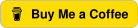

<picture>
  <source media="(prefers-color-scheme: dark)" srcset="./assets/adhd-hero-dark.svg">
  
</picture>

<b>Suyog Sontakke</b> · 💻 Full-Stack Developer | Building engaging web experiences with JavaScript, Firebase 🔥, and modern frontend tools 🎨. Passionate about serverless architecture

  

<b>Support my work</b> 

#### Signal

<picture>
  <source media="(prefers-color-scheme: dark)" srcset="./assets/adhd-signal-dark.svg">
  
</picture>

Reading the signal

- **Seismograph:** one swing of the pen per day of the last 365. The bigger the swing, the busier the day. Orange bands mark hyperfocus episodes, the most intense runs of back-to-back busy days. The biggest, HF-1, ran 3 days and logged 94 contributions.
- **Time, as experienced:** there are two times, now and not now. The bars under the clock are contributions by weekday (busiest: Sun).
- **Counters:** longest streak, contributions in the last 12 months, active days, stars, followers and years on GitHub.
- **Dopamine by source:** language share by bytes across public repositories.
- **The opening shot:** autofocus hunts through the noise, then locks on. The out-of-focus lights behind it are the last 12 months, one per month; bigger and brighter means busier.

ADHD isn’t a shortage of attention. Attention goes where interest is, and when it gets there it locks on hard. Artwork: original animated SVG, generated by README Templates · template: ADHD. Motion stops if your system asks for reduced motion.

#### Open tabs

- `TAB 01` **[ignite-2025-website](https://github.com/suyogsontakke/ignite-2025-website)**  
  HTML · ★ 1
- `TAB 02` **[Team-404-Err](https://github.com/suyogsontakke/Team-404-Err)** · EarthTrace  
  TypeScript
- `TAB 03` **[Cafe-Belini](https://github.com/suyogsontakke/Cafe-Belini)** · Cafe Belini  
  TypeScript
- `TAB 04` **[souls.of.culture](https://github.com/suyogsontakke/souls.of.culture)**  
  HTML

<picture>
  <source media="(prefers-color-scheme: dark)" srcset="./assets/adhd-end-dark.svg">
  
</picture>

